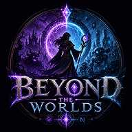

  

# Beyond the Worlds (Top_Down)

A top-down dungeon action game made by a team in Unreal Engine 5.4 during a game jam.

## What's inside

- **Dungeon levels**: each team member built their own map in `Content/Maps`
- **Enemy AI**: behavior for the dungeon enemies in `Content/AI`
- **Player character** with buffs and debuffs in `Content/MyCharacter`
- **Spells, magic circles and pickups** in `Content/Assets`
- **Portal system** for moving between areas in `Content/PortalSystem`

The project uses Blueprints only, so there is no C++ module to compile.

## Run it

1. Install **Unreal Engine 5.4** from the Epic Games Launcher.
2. Clone this repository and open `Top_Down.uproject`.
3. Open a level from `Content/Maps` and press **Play**.

## Credits

The dungeon, enemy, effects and environment art comes from third-party Unreal Marketplace / Fab packs (for example Fantastic Dungeon Pack, Mixed Magic VFX Pack, Brute Robot and Spider Robot). Those assets belong to their creators and are covered by their own licenses.
